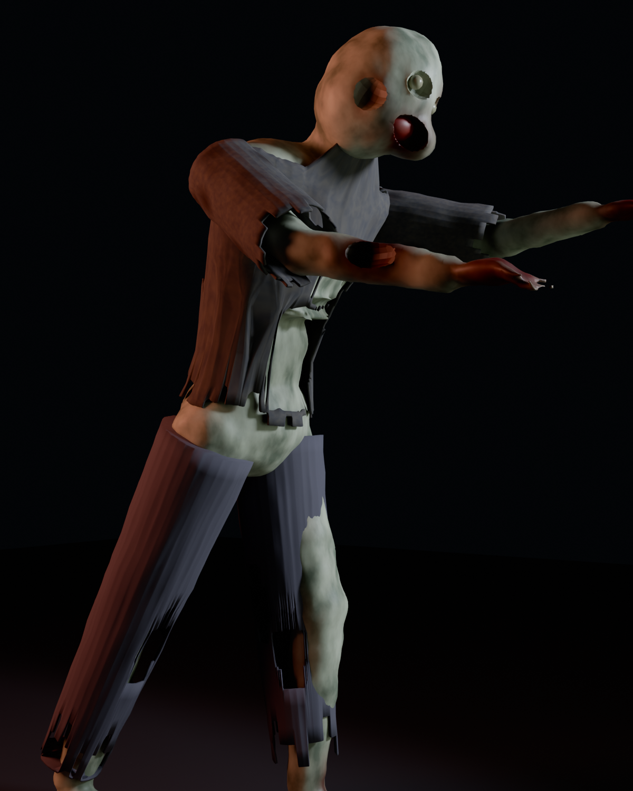

## 这是什么

`build_zombie.py` 三百多行，用 Blender 的 Python API（`bpy`）从空场景开始，一步步搭出一个风格化的生存恐怖丧尸：

1. 用球体、圆柱和锥体拼出驼背前倾的身体和四肢
2. 把它们融合成一整块有机网格
3. 雕出眼窝和张开的嘴
4. 按每段肢体的尺寸生成破烂的衣服
5. 配上材质、地面、灯光和相机，渲染出图并导出

在命令行里无界面运行：

```bash
blender -b -P build_zombie.py
```



## 做的过程中

[写写踩过的坑、学到的东西。]
